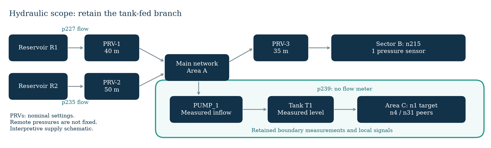
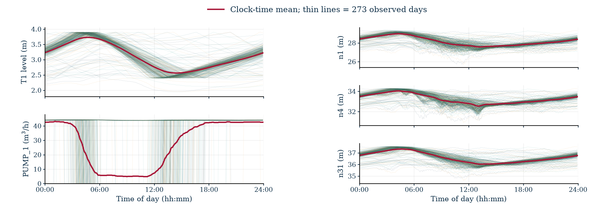
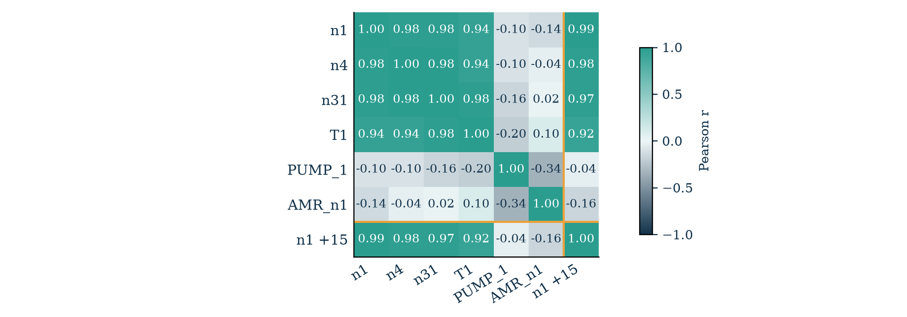
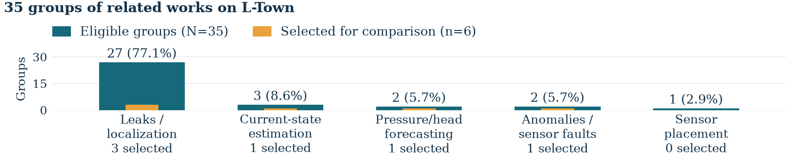

# Completed descriptive exploratory analysis

This page supports [Milestone 2, Sections 1.1–1.3 and Figures 1–4](../reports/Milestone2.pdf). The student specified measurements, visual questions and panel layout; AI generated and executed calculation/plotting code. The [contribution statement](student_contributions.md) and linked conversations distinguish these roles.

## Source and calculations

The pipeline verifies eleven [official inputs](../data/source_manifest.json): eight annual SCADA tables, nominal model, sensor configuration and README. It checks both years' table structure; descriptive errors and correlations use **January–September 2018**. Forecast evaluation on 2019 remains a planned final chronological assessment.

[Calculation code](../src/analysis.py) retains the six signals' recorded units and crops the period before `n1.shift(-3)`. The last three origins have targets outside the period, leaving **78,621 pairs from 78,624 timestamps**. These pairs support descriptive correlations and persistence. The proposed learning matrix will add 55-minute histories and history-availability checks.

For `e = n1(u + 15) − n1(u)`, MAE is the mean of `abs(e)` and RMSE is the square root of the mean of `e²`. Pearson correlations use the same aligned pairs, separating current predictors from the future label.

| Quantity | Recorded report value, reproduced within stored tolerances |
|---|---:|
| Days / timestamps | 273 / 78,624 |
| Valid +15-minute pairs | 78,621 |
| n1 minimum / maximum | 25.67 / 29.36 m |
| Persistence MAE | 0.05177624298851451 m |
| Persistence RMSE | 0.06849175638676988 m |
| Current n1 / future n1 correlation | 0.9923104288422752 |
| T1 / future n1 correlation | 0.9230382756150443 |
| PUMP_1 / future n1 correlation | −0.036721113537145696 |
| AMR_n1 / future n1 correlation | −0.1573783306135834 |

[Statistics](../results/eda_statistics.json) · [correlation table](../results/correlations.csv) · [verification](../results/verification.json)

## Four figures

**Figure 1 · Functional supply boundary.** [Nominal-network checks](../src/analysis.py) identify boundaries, pump endpoints and sensors; [plotting code](../src/figures.py) draws the interpretive supply-route schematic.

**Figure 2 · Daily profiles.** Thin lines represent 273 days; red shows the clock-time mean. Tank/pump panels match the combined height of the three pressure panels. Nominal controls open PUMP_1 below **2.4 m** and close it above **3.9 m**. The profiles describe local daily variation.

**Figure 3 · Correlations.** Gold separates the future label from six current signals. High n1 autocorrelation and small persistence error motivate the proposed lagged-model comparison. C3 would test added value beyond n1 history; pairwise associations alone do not establish it.

**Figure 4 · Literature groups.** Counts join source IDs with group assignments. Gold bars show selected subsets of five primary-objective categories. A diagnostic method may contain a future-pressure component.

[Screening notes](../literature/screening_notes.md) distinguish brief screening from six detailed comparisons. The [manifest](../results/run_manifest.json) records inputs, code, environment and outputs. [Retained report images](../evidence/submitted_figures/) remain separate from regenerated renderings with portable fonts. The student's retrospective reading account and recorded AI paper/code inspections are distinguished in [A06](../evidence/ai_interactions/README.md).
